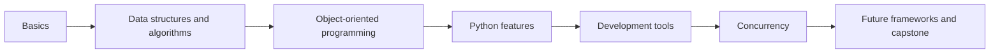
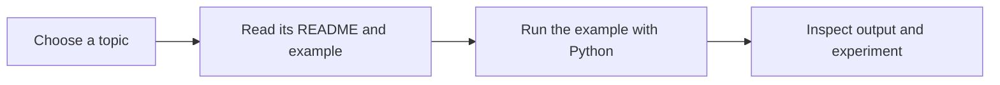

# Modern Python Developer Roadmap

Author: Saideep Bhange

This repository is a practical Python learning resource with examples and notes on Python concepts, data structures, and development tools. The roadmap and capstone below describe future learning goals, not completed projects.

> Source inspiration: Python Developer Roadmap (roadmap.sh) PDF uploaded alongside this repo.

## Repository Structure

```text
PythonCodes/
├── README.md
├── basics/
│   ├── README.md
│   ├── Basic Syntax.py
│   ├── Variables and Data Types.py
│   ├── Conditionals.py
│   ├── TypeCasting.py
│   ├── Exceptions.py
│   ├── FunctionsBuiltinFunctions.py
│   └── Loops.py
├── data_structures_algorithms/
│   ├── README.md
│   ├── collections/
│   │   ├── README.md
│   │   ├── Lists.py
│   │   ├── Tuples.py
│   │   ├── Sets.py
│   │   └── Dictionaries.py
│   ├── arrays_linked_lists/
│   │   ├── README.md
│   │   ├── Arrays.py
│   │   └── LinkedList.py
│   ├── binary_search_tree.py
│   ├── HashTable.py
│   ├── Heaps_Stacks_Queues.py
│   ├── Recursion.py
│   └── sorting_algorithms.py
├── object_oriented_programming/
│   ├── README.md
│   ├── Classes.py
│   ├── Inheritance.py
│   └── methods_dunder.py
├── python_features/
│   ├── README.md
│   ├── Decorators.py
│   ├── Iterators.py
│   ├── Lambdas.py
│   ├── RegularExpressions.py
│   └── modules/
│       ├── README.md
│       ├── Modules.py
│       └── my_module.py
├── development_tools/
│   ├── README.md
│   ├── common_packages_examples.py
│   ├── Environments.py
│   ├── package_managers.py
│   ├── Sphinx.py
│   ├── StaticTyping.py
│   └── Testing.py
├── concurrency/
│   ├── README.md
│   └── concurrency.py
└── devcontainer/
	└── devcontainer.json
```

## Learning Path

1. [Python basics](basics/README.md): syntax, variables, control flow, and functions.
2. [Data structures and algorithms](data_structures_algorithms/README.md): collections, arrays, trees, and algorithms.
3. [Object-oriented programming](object_oriented_programming/README.md): classes, inheritance, and special methods.
4. [Python features](python_features/README.md): decorators, iterators, regular expressions, and modules.
5. [Development tools](development_tools/README.md): environments, packages, typing, documentation, and testing.
6. [Concurrency](concurrency/README.md): threads, processes, and asynchronous tasks.

### Learning Workflow



### Run an Example

Install Python 3, open a terminal at the repository root, and run an example using its path:

```bash
python "basics/Exceptions.py"
```

Read each example before running it: some are reference notes, some demonstrate errors or require input, and some perform file operations. Individual topic guides identify known special requirements. Third-party tools mentioned in the notes are optional unless you choose to try them.



## 🎯 Goals
- Master Python fundamentals and data structures
- Get comfortable with packaging, environments, typing, documentation, formatting, and testing
- Learn synchronous & asynchronous web frameworks
- Understand concurrency (threads, processes, async)
- Build, package, document, and test a production-grade project

## 📚 Curriculum Outline
The following is a broader study plan inspired by the roadmap. Topics beyond the linked learning folders, exercises, and the capstone are future goals rather than completed materials.

### 1) Learn the Basics
- Basic syntax, variables & data types
- Conditionals, type casting, exceptions
- Functions (incl. builtins), lambdas, decorators, iterators
- Comprehensions & generator expressions
- Regular expressions
- Modules & packages

### 2) Data Structures & Algorithms
- Lists, tuples, sets, dicts
- Arrays & linked lists
- Stacks, queues, heaps
- Hash tables
- Binary search tree
- Recursion & sorting algorithms

### 3) Object-Oriented Programming
- Classes, instances, methods (incl. dunder methods)
- Inheritance & composition
- Context managers

### 4) Package Managers & Environments
- pip / PyPI, pipx
- Poetry or pip-tools
- Conda (optional)
- virtualenv, pyenv
- `pyproject.toml` and build backends
- Pipenv (optional)

### 5) Static Typing
- `typing` module
- mypy / pyright / pyre
- Pydantic for data validation

### 6) Code Quality
- Formatters: black, yapf
- Linters: ruff
- Docstrings & documentation generators: Sphinx / MkDocs
- Pre-commit hooks
- tox / nox for matrix testing

### 7) Testing
- unittest / pyUnit
- pytest
- doctest (optional)

### 8) Concurrency & Asynchrony
- GIL & when it matters
- Threading, multiprocessing
- Asynchronous programming (`asyncio`), event loops
- uvicorn (ASGI server)

### 9) Learn a Framework
- Sync: Flask / Django / Pyramid
- Async: FastAPI / aiohttp / Sanic / Tornado
- Dash / Plotly for data apps

### 10) DevOps Foundations
- Packaging & publishing to PyPI (testpypi first)
- Docker basics
- CI/CD (GitHub Actions)
- Versioning & releases

---

## 🏗 Future Capstone Project: **DataHub 360**

A production-grade **data-driven web service** with:
- **FastAPI** backend (ASGI) + async I/O
- **Celery / RQ** (or `asyncio` tasks) for background jobs
- **PostgreSQL** (SQLModel/SQLAlchemy) + Redis
- **Pydantic** models with strict typing
- **pytest** + coverage + property-based tests
- **black** + **ruff** + pre-commit
- **Sphinx** docs published to GitHub Pages
- **Docker** containers and GitHub Actions CI
- Optional **Dash** micro-UI for analytics

### Core Features
1. Ingest CSV/JSON datasets via API (async file upload and validation)
2. Store datasets and metadata in Postgres
3. Run async analysis jobs (descriptive stats, profiling)
4. Expose results via REST endpoints
5. Serve live charts via a small Dash app or a static frontend
6. Role-based users & tokens (FastAPI dependencies)
7. Background scheduled cleanups
8. Health checks and metrics endpoint

### Tech Mapping (Roadmap ➜ Feature)
- **Basics/OOP** → project structure, modules, dunder methods
- **DS&A** → efficient parsing, queues/priority jobs
- **Typing/Pydantic** → strict data validation
- **Async/Concurrency** → async endpoints & workers
- **Framework** → FastAPI + uvicorn
- **Testing** → pytest unit/integration tests
- **Quality** → black, ruff, pre-commit
- **Docs** → Sphinx + autodoc
- **DevOps** → Dockerfile, compose, GitHub Actions