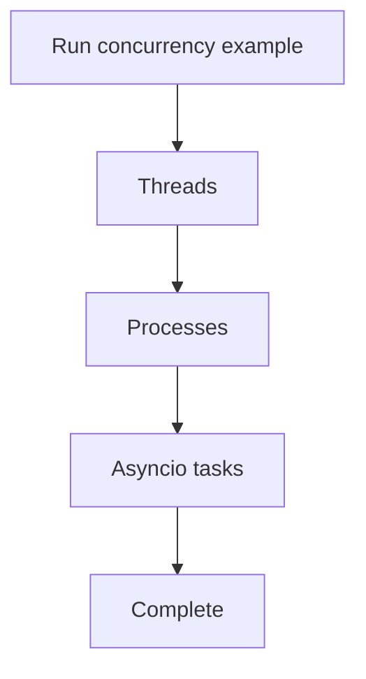

# Concurrency

The [concurrency example](concurrency.py) compares threads, multiprocessing, and asynchronous tasks using Python 3 standard-library modules. Understanding functions and the basics of Python execution is useful before starting.

From the repository root:

```bash
python concurrency/concurrency.py
```

The example runs all three demonstrations and includes timed waits; process and thread output can appear in different orders.



[Back to the learning path](../README.md#learning-path)