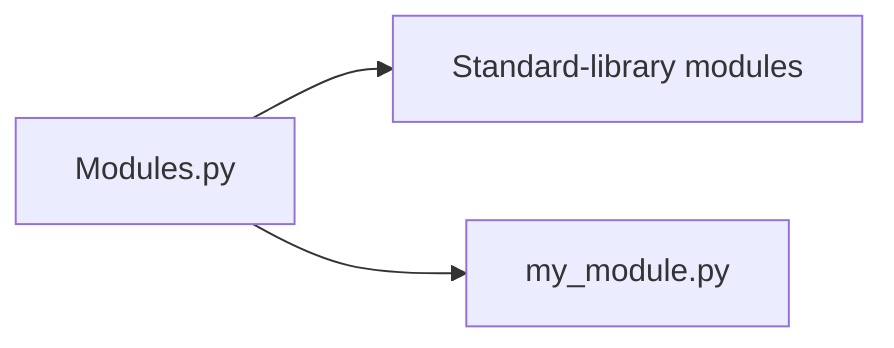

# Modules and Imports

Learn how Python imports standard-library modules and a local module. The [main example](Modules.py) imports [my_module.py](my_module.py), so keep both files together. Python 3 is required.

From the repository root:

```bash
python python_features/modules/Modules.py
```



[Back to Python features](../README.md)